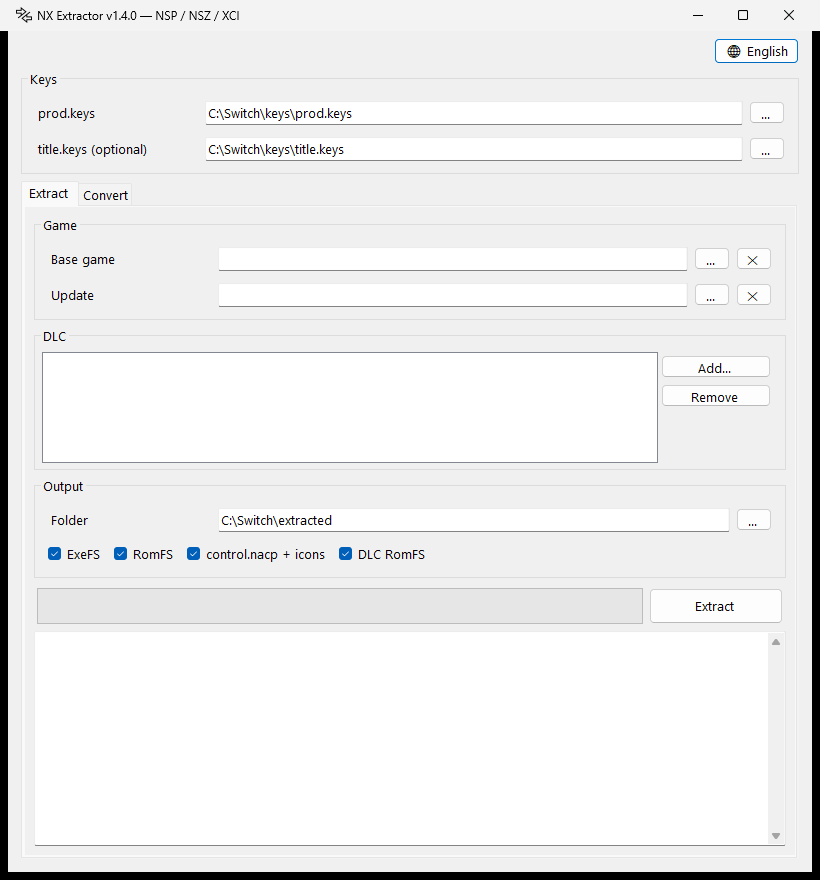

# NX Extractor

<p align="center">
  <picture>
    <source media="(prefers-color-scheme: dark)" srcset="docs/icon-dark.png">
    
  </picture>
</p>

A simple Windows tool to extract and convert Nintendo Switch game dumps — no command line, no emulator required.

*Español más abajo.*

<p align="center">
  
</p>

## Features

**Extract**
- ExeFS, RomFS (with the update applied on top of the base game), DLC RomFS
- `control.nacp` plus icons, and an `info.txt` with the title name and version
- Input: NSP, NSZ, XCI, XCZ
- **Switch 2 `.nup` packages** (already decrypted, no keys needed): ExeFS and RomFS, with updates in the package applied on top of the base

**Convert**
- XCI / XCZ → NSP
- NSZ → NSP
- NSP / XCI → NSZ (zstd level 1–22)
- Extracted Switch 2 game folder → `.nup` (`exefs/` + `romfs/`, or `base/` + `updates/<version>/`), readable by Lichii / Eglantine
- Batch conversion, drag & drop

**Other**
- Single self-contained `.exe` (no .NET install needed)
- Interface in English, Español, Français, 日本語 and Deutsch

## Usage

1. Download `NxExtractor.exe` from [Releases](../../releases).
2. Provide your own `prod.keys` (and optionally `title.keys`), dumped from your own console.
   If you put them next to the exe or in `%USERPROFILE%\.switch`, they are picked up automatically.
3. **Extract** tab: choose the base game, update and DLC, pick what to extract and click *Extract*.
4. **Convert** tab: add files, choose *to NSP* or *to NSZ* and click *Convert*.

Output layout:

```
<output>/<TitleID>/
  exefs/
  romfs/
  control.nacp
  control/
  info.txt
  dlc/<DLC TitleID>/romfs/
```

## Notes

- This tool does **not** include any keys or game content. Use it only with games you own.
- An update without its base game can only give the ExeFS (the update RomFS is a patch).
- NSP → XCI is not supported.
- NUP files can be extracted, and extracted folders can be packed back into a NUP, but NUP cannot be converted to NSP/NSZ.

## Building

Requires the .NET 8 SDK.

```
dotnet publish -c Release -o dist
```

## Credits

Built on [LibHac](https://github.com/Thealexbarney/LibHac) and [ZstdSharp](https://github.com/oleg-st/ZstdSharp).

---

## Español

Herramienta para Windows que extrae y convierte dumps de juegos de Nintendo Switch, sin línea de comandos ni emulador.

- **Extraer:** ExeFS, RomFS (con el update aplicado), RomFS de DLC y `control.nacp` con iconos, desde NSP, NSZ, XCI o XCZ. También ExeFS y RomFS de paquetes `.nup` de Switch 2 (ya descifrados, sin claves).
- **Convertir:** XCI/XCZ → NSP, NSZ → NSP, NSP/XCI → NSZ, por lotes. Y carpetas de juegos de Switch 2 extraídos → `.nup`.
- Un solo `.exe`, sin instalar nada. Interfaz en 5 idiomas.

Las claves (`prod.keys` y `title.keys`) las pones tú, sacadas de tu propia consola. La herramienta no incluye claves ni juegos.
